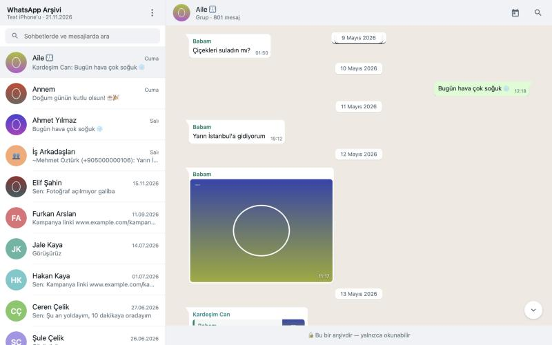
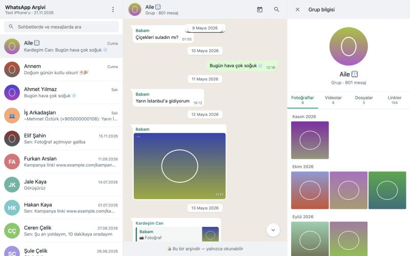

# WhatsApp Arşivi (WhatsApp Archive)

[Türkçe](README.md) | **English**

A **read-only** Windows program that imports **all your WhatsApp chats** (including photos, videos, voice messages
and documents) from your iPhone's computer backup in one go, and shows them in a WhatsApp-like window.
It cannot send messages and never connects to the internet; everything stays on your own computer.

> The program's interface is in **Turkish**. This page explains every step in English, including the menu labels.




> The people, messages and phone numbers in the screenshots are fake data generated for testing.

## Features

- **Bulk import:** No need to export chats one by one with WhatsApp's "Export chat"; every chat in the iPhone backup
  is imported at once, with no 10,000 / 40,000 message limit. Encrypted backups are supported too.
- **Copy-free and fast:** If the program is on the same disk as the backup, media files are not copied but taken as
  hard links, so no extra disk space is used. The archive stays intact even if the backup is later updated or deleted.
- **Looks like WhatsApp:** Bubbles, date separators, colored names of group members, quoted replies, deleted
  messages, location and contact cards; light and dark theme.
- **Media:** Photos, videos, GIFs, stickers and voice messages open inside the program; documents open with the
  default program on your computer.
- **Contact / group info:** Click the chat header to see the **Photos, Videos, Documents, Links** tabs
  (*Fotoğraflar, Videolar, Dosyalar, Linkler*; only tabs that have content are shown). In the photo viewer you can
  browse from the chat's first photo to the last with ← →, and jump back to the message with *Mesaja git*
  ("Go to message").
- **The whole chat:** When a chat opens, the newest messages appear immediately and the rest loads in the background
  back to the very first message (smooth even with tens of thousands of messages).
- **Search:** Across all chats or within one chat; Turkish characters don't matter ("sukru" finds "Şükrü").
  Jump to a specific date.
- **Portable:** No installation; copy the folder to an external drive and open it on another computer.

## Download and usage

1. Download **`WhatsApp-Arsivi-Windows.zip`** from the [Releases](../../releases/latest) page.
2. Right-click the zip, choose **Extract All**, and open **`WhatsApp Arsivi.exe`** in the extracted folder.
   - The program is not code-signed, so on first launch Windows may show "Windows protected your PC":
     click **More info → Run anyway**.
   - If the `.exe` doesn't start, use **`Alternatif Baslatici.bat`** ("alternative launcher") in the same folder.
3. Make an iPhone backup (once):
   1. On the iPhone, go to **WhatsApp → Settings → Chats → Chat Backup**: if **End-to-end Encrypted Backup** is on,
      turn it off (while it is on, WhatsApp chats are not included in the computer backup).
   2. Connect the iPhone to the computer with a cable and tap **Trust This Computer** on the phone.
   3. In **Apple Devices** (Microsoft Store) or **iTunes**, select the iPhone and choose
      **"Back up all of the data on your iPhone to this computer" → Back Up Now**.
4. In the program, open the menu at the top right (⋮) and choose **iPhone yedeğinden içe aktar**
   ("Import from iPhone backup"). The program finds the backup by itself
   (`%APPDATA%\Apple Computer\MobileSync\Backup` or `%USERPROFILE%\Apple\MobileSync\Backup`); if it is somewhere
   else, point to it with **Başka bir klasör seç…** ("Choose another folder…").

Everything you import is kept in the **`Arsiv_Verisi`** folder inside the program folder. You can import more than
one archive (e.g. an old and a new phone). Windows Explorer shows this folder's size including the linked files;
linked media take up space on disk only once.

### Known limitations

- Only **iPhone** backups are supported (no Android support yet).
- Call logs, emoji reactions and poll options are not shown.
- Media that were never downloaded or were deleted on the phone are not in the backup either; they appear as
  "dosya yedekte yok" ("file not in backup").
- Photos that the window can't display, such as HEIC, appear as a card that opens in your system's program when
  clicked.

## Privacy

- The program only uses a small local server running on `127.0.0.1` with a per-session key; it makes no outside
  connections. Links open in your browser only when you click them.
- It never writes to the iPhone backup. The password of an encrypted backup is kept in memory only during the import.

## Development

Requires: Python 3.11+

```bash
pip install -r requirements.txt          # window (pywebview) and encrypted backup support
python main.py                           # open the program
python main.py --tarayici                # open in the browser instead of a window
```

The tests generate a fake iPhone backup, import it and query the archive:

```bash
pip install -r requirements-dev.txt
python -m unittest discover -s tests -v
```

To try the interface with a fake backup:

```bash
python dev/make_fake_backup.py /tmp/sahte_yedek
WA_ARSIV_VERI=/tmp/arsiv WA_ARSIV_YEDEK_KOK=/tmp/sahte_yedek python dev/run_dev.py 8765
```

### Windows package

The Windows package (portable Python + libraries + launcher .exe) can be built on any operating system:

```bash
pip install pillow
python dev/build_windows_package.py --download --out dist
```

When a tag such as `v1.2.0` is pushed to GitHub, the **Windows paketi** workflow builds the package, tests it on a
real Windows machine with a fake backup, and uploads it to the Releases page:

```bash
git tag v1.2.0
git push origin v1.2.0
```

Alternatively, `build.bat` can be used on Windows to build a single-file .exe with PyInstaller.

### Code structure

| File | Purpose |
| --- | --- |
| `wa_arsiv/importer.py` | Finding backups, importing, hard links, encrypted backups (`iphone_backup_decrypt`) |
| `wa_arsiv/archive.py` | Reading the WhatsApp database (`ChatStorage.sqlite`), search index, media/link lists |
| `wa_arsiv/server.py` | Local server that feeds data to the interface |
| `wa_arsiv/web/` | Interface (HTML/CSS/JS; works without an internet connection) |
| `main.py` | Opens the window (pywebview / Edge WebView2) |
| `dev/` | Fake backup generator, development server, Windows packager |
| `tests/` | End-to-end tests |

Contributions are welcome: open an *issue* to report a bug or send a *pull request*.
Please don't share real message content or personal information when reporting bugs.
Issues and pull requests can be written in English or Turkish.

## License and disclaimer

[MIT](LICENSE). This project is not affiliated with, endorsed by or sponsored by WhatsApp LLC or Meta Platforms, Inc.
"WhatsApp" is a trademark of WhatsApp LLC. The program is only for viewing data from your own device's backup.
