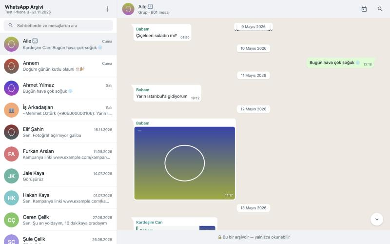
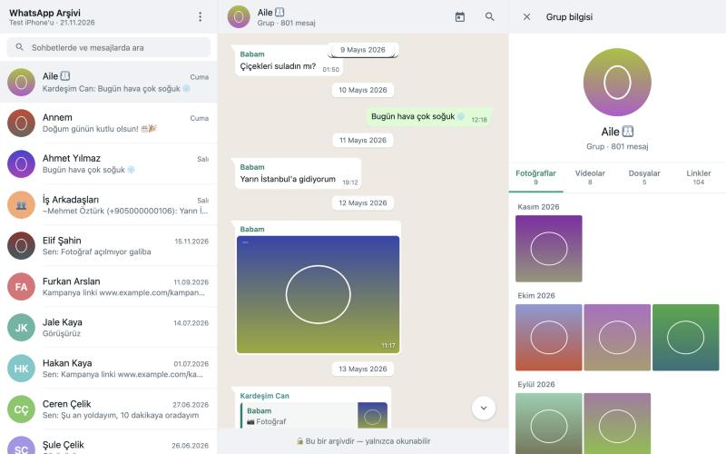

# WhatsApp Arşivi

iPhone'un bilgisayardaki yedeğinden **tüm WhatsApp sohbetlerinizi** (fotoğraf, video, sesli mesaj ve belgeler dahil)
tek seferde içe aktaran ve WhatsApp'a benzeyen bir pencerede gösteren, **salt okunur** bir Windows programı.
Mesaj gönderemez, internete bağlanmaz; her şey yalnızca sizin bilgisayarınızda kalır.




> Ekran görüntülerindeki kişiler, mesajlar ve numaralar test için üretilmiş sahte verilerdir.

## Özellikler

- **Toplu içe aktarma:** WhatsApp'ın "Sohbeti dışa aktar" özelliğiyle tek tek uğraşmak yok; iPhone yedeğindeki
  bütün sohbetler bir kerede alınır. 10.000 / 40.000 mesaj sınırı yoktur. Şifreli yedekler de desteklenir.
- **Kopyasız ve hızlı:** Program yedekle aynı diskteyse medyalar kopyalanmaz, sabit bağlantıyla (hard link) alınır;
  ek disk alanı kullanılmaz. Yedek sonradan güncellense ya da silinse bile arşiv yerinde kalır.
- **WhatsApp gibi görünüm:** Baloncuklar, tarih ayırıcıları, grup üyelerinin renkli isimleri, alıntılanan yanıtlar,
  silinen mesajlar, konum ve kişi kartları; açık ve koyu tema.
- **Medya:** Fotoğraflar, videolar, GIF'ler, çıkartmalar ve sesli mesajlar programın içinde açılır; belgeler
  bilgisayardaki programla açılır.
- **Kişi / grup bilgisi:** Sohbetin başlığına tıklayınca **Fotoğraflar, Videolar, Dosyalar, Linkler** sekmeleri
  (yalnızca içeriği olan sekmeler görünür). Fotoğraf görüntüleyicide sohbetin ilk fotoğrafından sonuncusuna
  ← → ile gezilebilir; "Mesaja git" ile o mesaja dönülür.
- **Sohbetin tamamı:** Bir sohbet açılınca en yeni mesajlar hemen görünür, kalanı ilk mesaja kadar arka planda
  yüklenir (on binlerce mesajlık sohbetlerde de akıcıdır).
- **Arama:** Tüm sohbetlerde ya da tek sohbette; Türkçe karakter fark etmez (“sukru” yazınca “Şükrü” bulunur).
  Belirli bir tarihe gitme.
- **Taşınabilir:** Kurulum gerektirmez; klasörü harici diske kopyalayıp başka bilgisayarda açabilirsiniz.

## İndirme ve kullanım

1. [Releases](../../releases/latest) sayfasından **`WhatsApp-Arsivi-Windows.zip`** dosyasını indirin.
2. Zip'e sağ tıklayıp **Tümünü ayıkla** deyin ve çıkan klasördeki **`WhatsApp Arsivi.exe`**'yi açın.
   - Program imzalı olmadığı için ilk açılışta “Windows bilgisayarınızı korudu” uyarısı çıkabilir:
     **Ek bilgi → Yine de çalıştır**.
   - `.exe` açılmazsa aynı klasördeki **`Alternatif Baslatici.bat`** ile başlatın.
3. iPhone yedeğini alın (bir kez):
   1. iPhone'da **WhatsApp → Ayarlar → Sohbetler → Sohbet Yedeği**: **Uçtan Uca Şifreli Yedekleme** açıksa kapatın
      (açıkken WhatsApp sohbetleri bilgisayar yedeğine girmez).
   2. iPhone'u kabloyla bilgisayara bağlayın, telefonda **Bu Bilgisayara Güven** deyin.
   3. **Apple Aygıtları** (Microsoft Store) ya da **iTunes**'ta iPhone'u seçip
      **“iPhone'unuzdaki tüm verileri bu bilgisayara yedekleyin” → Şimdi Yedekle**.
4. Programda sağ üstteki menüden (⋮) **iPhone yedeğinden içe aktar**'ı seçin. Program yedeği kendisi bulur
   (`%APPDATA%\Apple Computer\MobileSync\Backup` veya `%USERPROFILE%\Apple\MobileSync\Backup`); başka bir
   yerdeyse **Başka bir klasör seç…** ile gösterin.

İçe aktarılan her şey program klasöründeki **`Arsiv_Verisi`** klasöründe durur. Birden fazla arşiv (ör. eski ve yeni
telefon) içe aktarılabilir. Windows Gezgini bu klasörün boyutunu bağlantılı dosyalarla birlikte tam gösterir;
bağlantılı medyalar diskte yalnızca bir kez yer kaplar.

### Bilinen sınırlamalar

- Yalnızca **iPhone** yedekleri desteklenir (Android desteği henüz yok).
- Çağrı kayıtları, emoji tepkileri ve anket seçenekleri gösterilmez.
- Telefonda indirilmemiş/silinmiş medyalar yedekte de yoktur; “dosya yedekte yok” olarak görünür.
- HEIC gibi pencerede gösterilemeyen fotoğraflar, tıklayınca sistemdeki programla açılan bir kart olarak görünür.

## Gizlilik

- Program yalnızca `127.0.0.1` üzerinde, oturuma özel bir anahtarla çalışan küçük bir yerel sunucu kullanır;
  dışarıya hiçbir bağlantı kurmaz. Linkler yalnızca siz tıklarsanız tarayıcıda açılır.
- iPhone yedeğine hiçbir zaman yazılmaz. Şifreli yedeklerin şifresi yalnızca içe aktarma sırasında bellekte tutulur.

## Geliştirme

Gereken: Python 3.11+

```bash
pip install -r requirements.txt          # pencere (pywebview) ve şifreli yedek desteği
python main.py                           # programı aç
python main.py --tarayici                # pencere yerine tarayıcıda aç
```

Testler sahte bir iPhone yedeği üretip içe aktarır ve arşivi sorgular:

```bash
pip install -r requirements-dev.txt
python -m unittest discover -s tests -v
```

Sahte yedekle arayüzü denemek için:

```bash
python dev/make_fake_backup.py /tmp/sahte_yedek
WA_ARSIV_VERI=/tmp/arsiv WA_ARSIV_YEDEK_KOK=/tmp/sahte_yedek python dev/run_dev.py 8765
```

### Windows paketi

Windows paketi (taşınabilir Python + kütüphaneler + başlatıcı .exe) herhangi bir işletim sisteminde üretilebilir:

```bash
pip install pillow
python dev/build_windows_package.py --download --out dist
```

GitHub'da `v1.2.0` gibi bir etiket gönderildiğinde **Windows paketi** iş akışı paketi üretir, gerçek bir Windows
makinesinde sahte yedekle dener ve Releases sayfasına yükler:

```bash
git tag v1.1.0
git push origin v1.1.0
```

Alternatif olarak Windows'ta PyInstaller ile tek dosyalık .exe üretmek için `build.bat` kullanılabilir.

### Kod yapısı

| Dosya | Görev |
| --- | --- |
| `wa_arsiv/importer.py` | Yedeği bulma, içe aktarma, sabit bağlantılar, şifreli yedekler (`iphone_backup_decrypt`) |
| `wa_arsiv/archive.py` | WhatsApp veritabanını (`ChatStorage.sqlite`) okuma, arama dizini, medya/link listesi |
| `wa_arsiv/server.py` | Arayüze veri veren yerel sunucu |
| `wa_arsiv/web/` | Arayüz (HTML/CSS/JS; internet bağlantısı gerektirmez) |
| `main.py` | Pencereyi (pywebview / Edge WebView2) açar |
| `dev/` | Sahte yedek üretici, geliştirme sunucusu, Windows paketleyici |
| `tests/` | Uçtan uca testler |

Katkılar memnuniyetle karşılanır: hata bildirimi için bir *issue* açın ya da *pull request* gönderin.
Lütfen hata bildirirken gerçek mesaj içeriği veya kişisel bilgi paylaşmayın.

## English

**WhatsApp Arşivi** is a read-only Windows viewer for WhatsApp chats stored in a local iPhone (iTunes / Apple Devices)
backup. It imports all chats at once (including photos, videos, voice notes and documents), shows them in a
WhatsApp-like window with per-chat media/docs/links tabs and full-text search, and never connects to the internet.
Download the portable zip from [Releases](../../releases/latest); no installation needed. The UI is in Turkish.

## Lisans ve uyarı

[MIT](LICENSE). Bu proje WhatsApp LLC veya Meta Platforms, Inc. ile bağlantılı değildir; onlar tarafından
desteklenmez. “WhatsApp”, WhatsApp LLC'nin ticari markasıdır. Program yalnızca kendi cihazınızın yedeğindeki
verileri görüntülemek içindir.
